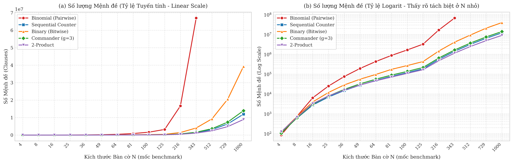
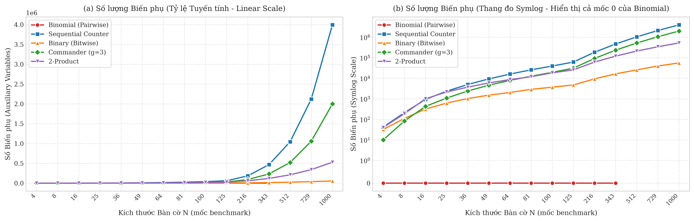
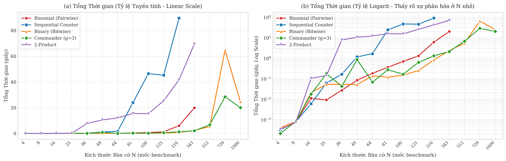
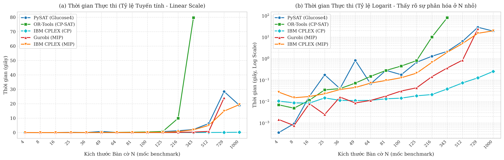

# Nghiên cứu Thực nghiệm SAT Encodings và So sánh Đa Mô hình (SAT, CP, MIP) cho Bài toán N-Queens

**Học phần:** Các vấn đề hiện đại trong Khoa học Máy tính  
**Tác giả:** **Trần Nhật Hưng**  

---

## 📌 Giới thiệu Đề tài

Bài toán **$N$-Queens (Xếp $N$ quân hậu)** là bài toán kinh điển trong Khoa học Máy tính và Trí tuệ Nhân tạo: *Tìm cách đặt $N$ quân hậu trên bàn cờ kích thước $N \times N$ sao cho không có hai quân hậu nào có thể tấn công lẫn nhau* (nghĩa là không cùng hàng, không cùng cột và không cùng đường chéo).

Dự án này tập trung triển khai và đánh giá thực nghiệm chuyên sâu:
1. **5 kỹ thuật mã hóa ràng buộc At-Most-One (AMO) trong SAT Solving:**
   - **Binomial (Pairwise / Cổ điển)**: Đơn giản, $0$ biến phụ, số mệnh đề bùng nổ $O(N^4)$.
   - **Sequential Counter (Sinz 2005)**: Thanh ghi tích lũy tuyến tính, duy trì Arc-Consistency (GAC).
   - **Binary (Bitwise)**: Mã hóa bit nhị phân, tối ưu hóa số biến phụ $O(N \log N)$.
   - **Commander Variable (Klieber & Kwon 2007)**: Phân cấp biến chỉ huy theo nhóm ($g=3$), cân bằng biến phụ và mệnh đề.
   - **2-Product (Chen 2010)**: Phân bố ma trận phụ 2 chiều $p \times q$, biến phụ $O(N^{1.5})$.
   - Bộ giải SAT chính được sử dụng: **PySAT Glucose4** 

2. **So sánh Đa Mô hình (Cross-Paradigm Benchmark) giữa 3 trường phái giải chính xác:**
   - **SAT Solving (Logic Mệnh đề):** PySAT Glucose4 (sử dụng mã hóa **Commander Variable** đại diện).
   - **Constraint Programming (CP):** Google OR-Tools (CP-SAT), IBM ILOG CPLEX (CP Optimizer).
   - **Mixed Integer Programming (MIP / 0-1 ILP):** Gurobi Optimizer, IBM ILOG CPLEX (MIP).

---

## 📂 Cấu trúc Thư mục Dự án

```text
N_Queens_2/
├── README.md                      # Tài liệu hướng dẫn dự án
├── requirements.txt               # Danh sách thư viện Python cần thiết
├── src/                           # Mã nguồn triển khai các giải thuật
│   ├── binomial.py                # SAT Solver với Binomial (Pairwise) Encoding
│   ├── sequential.py              # SAT Solver với Sequential Counter Encoding
│   ├── binary.py                  # SAT Solver với Binary (Bitwise) Encoding
│   ├── commander.py               # SAT Solver với Commander Variable Encoding
│   ├── product.py                 # SAT Solver với 2-Product Encoding
│   ├── sat.py                     # CLI điều phối trung tâm cho SAT Solvers
│   ├── cpsat.py                   # Constraint Programming với Google OR-Tools CP-SAT
│   ├── cplex_cp.py                # Constraint Programming với IBM CPLEX CP Optimizer
│   ├── gurobi.py                  # 0-1 MIP với Gurobi Optimizer
│   └── cplex_mip.py               # 0-1 MIP với IBM CPLEX MIP
└── results/                       # Thực nghiệm, Dữ liệu và Trực quan hóa
    ├── benchmark/                 # Kịch bản tự động hóa đo đạc thực nghiệm
    │   ├── encoding.py            # Benchmark so sánh 5 phương pháp SAT Encoding
    │   └── solver.py              # Benchmark so sánh 5 Solvers
    ├── data/                      # Dữ liệu thực nghiệm dạng CSV
    │   ├── encoding.csv           # Dữ liệu thực nghiệm Encodings
    │   └── solver.csv             # Dữ liệu thực nghiệm Solvers
    ├── figures/                   # Thư mục lưu trữ biểu đồ
    │   ├── encoding_clauses.png   # Biểu đồ số lượng mệnh đề CNF giữa các SAT Encodings
    │   ├── encoding_aux_vars.png  # Biểu đồ số lượng biến phụ giữa các SAT Encodings
    │   ├── encoding_total_time.png# Biểu đồ tổng thời gian thực thi của các SAT Encodings
    │   └── solver_total_time.png  # Biểu đồ so sánh thời gian thực thi đa mô hình (SAT vs CP vs MIP)
    └── visualization/             # Jupyter Notebooks phân tích và trực quan hóa
        ├── encoding.ipynb         # Phân tích 5 kỹ thuật SAT Encodings
        └── solver.ipynb           # So sánh thời gian thực thi SAT vs CP vs MIP
```

---

## ⚙️ Cài đặt Môi trường (Installation)

### 1. Khởi tạo môi trường ảo Python
Khuyến nghị sử dụng Python 3.10 trở lên:

```bash
# Tạo môi trường ảo
python3 -m venv .venv

# Kích hoạt môi trường ảo
source .venv/bin/activate  # Trên Linux / macOS
# .venv\Scripts\activate   # Trên Windows
```

### 2. Cài đặt các thư viện phụ thuộc
Cài đặt toàn bộ dependencies qua `requirements.txt`:

```bash
pip install -r requirements.txt
```

> **Lưu ý về Solvers & Bản quyền Học thuật (Academic Licenses):**
> - **PySAT (Glucose4)** và **Google OR-Tools** là thư viện mã nguồn mở, hoạt động không giới hạn kích thước bài toán.
> - **IBM CPLEX (CP Optimizer & MIP):** và **Gurobi Optimizer:** cần xin license để chạy được với số lượng N lớn.

---

## 🚀 Hướng dẫn Sử dụng (Usage & Quickstart)

### 1. Giải bài toán N-Queens bằng SAT Solvers (CLI)
Sử dụng file điều phối `src/sat.py` để giải và in trực quan bàn cờ nghiệm:

```bash
# Giải bài toán 8-Queens bằng Sequential Counter Encoding (Glucose4)
python src/sat.py -n 8 -e sequential

# Giải bài toán 12-Queens bằng Binary Encoding
python src/sat.py -n 12 -e binary

# Giải bài toán 10-Queens bằng Commander Variable Encoding
python src/sat.py -n 10 -e commander
```

### 2. Chạy thử nghiệm các Solver khác
Các solver đều được chuẩn hóa chạy trực tiếp với giá trị mặc định chuẩn $N = 8$:

```bash
# Giải bằng Google OR-Tools CP-SAT (Ràng buộc toàn cục AllDifferent)
python src/cpsat.py

# Giải bằng Gurobi MIP (0-1 Linear Programming)
python src/gurobi.py

# Giải bằng IBM CPLEX CP Optimizer
python src/cplex_cp.py

# Giải bằng IBM CPLEX MIP
python src/cplex_mip.py
```

### 3. Tự động hóa Đo đạc Thực nghiệm (Benchmarks)
Các script trong `results/benchmark/` tự động chạy thực nghiệm và cập nhật số liệu trực tiếp vào `results/data/`:

```bash
# Đo đạc 5 phương pháp SAT Encoding (mặc định 15 mốc: N=4 đến N=1000)
python results/benchmark/encoding.py

# Đo đạc so sánh 5 Solvers (SAT Glucose4 Commander, CP-SAT, CPLEX CP, Gurobi, CPLEX MIP)
python results/benchmark/solver.py
```

### 4. Khám phá Trực quan hóa & Phân tích (Jupyter Notebooks)
Khởi chạy Jupyter Notebook để xem các phân tích chi tiết, bảng thống kê và biểu đồ:

```bash
jupyter notebook results/visualization/encoding.ipynb
jupyter notebook results/visualization/solver.ipynb
```

---

## 📊 Tóm tắt Kết quả Thực nghiệm Chính

### 1. So sánh các Kỹ thuật SAT Encoding (trên Glucose4)

| Kỹ thuật Encoding | Biến phụ ($m$ biến) | Mệnh đề CNF ($m$ biến) | Tổng Mệnh đề N-Queens | Đánh giá Thực nghiệm (15 mốc $N \in [4 \to 1000]$) |
| :--- | :---: | :---: | :---: | :--- |
| **Binomial (Pairwise)** | $0$ | $O(m^2)$ | $O(N^4)$ | Rất nhanh ở $N \le 25$; giải được đến $N = 343$ ($19.9\text{s}$ với $67.0\text{M}$ mệnh đề); bùng nổ bộ nhớ (OOM) ở $N \ge 512$. |
| **Sequential Counter** | $O(m)$ | $O(m)$ | $O(N^2)$ | Duy trì Arc-Consistency mạnh; giải được đến $N = 216$ ($89.7\text{s}$); chạm timeout ($120\text{s}$) tại $N \ge 343$ do lượng biến phụ khổng lồ ($3.99\text{M}$ biến tại $N=1000$) làm bùng nổ không gian phân nhánh. |
| **Binary (Bitwise)** | $O(\log m)$ | $O(m \log m)$ | $O(N^2 \log N)$ | **Tiết kiệm biến phụ nhất** (chỉ $55.9\text{K}$ biến phụ tại $N = 1000$), nhanh nhất ở phân khúc trung bình $N \in [49, 216]$ (chỉ $0.81\text{s}$ tại $N = 216$), **giải ổn định tới $N = 1000$** ($24.7\text{s}$). |
| **Commander Variable** | $O(m/g)$ | $O(m)$ | $O(N^2)$ | Cân bằng hoàn hảo giữa biến phụ và mệnh đề ($g=3$); giải tốt ở $N = 216$ ($1.29\text{s}$); **nhanh nhất ở quy mô cực lớn** ($N \ge 343$) và **giải ổn định tới $N = 1000$** ($20.1\text{s}$, đạt $18.9\text{s}$ ở benchmark solver). |
| **2-Product** | $O(\sqrt{m})$ | $O(m)$ | $O(N^2)$ | Cấu trúc ma trận 2D hiệu quả; giải tốt đến $N = 343$ ($69.6\text{s}$); chạm timeout ở $N \ge 512$. |

#### Trực quan hóa Thực nghiệm SAT Encodings:

<p align="center">
  
  <br/><em>Hình 1: So sánh số lượng mệnh đề CNF (Tuyến tính và Logarit) giữa 5 kỹ thuật SAT Encoding.</em>
</p>

<p align="center">
  
  <br/><em>Hình 2: So sánh số lượng biến phụ (Tuyến tính và Symlog) giữa 5 kỹ thuật SAT Encoding.</em>
</p>

<p align="center">
  
  <br/><em>Hình 3: Tổng thời gian thực thi (Tuyến tính và Logarit) của 5 kỹ thuật SAT Encoding trên Glucose4.</em>
</p>

---

### 2. So sánh Đa Mô hình: SAT (Glucose4 Commander) vs CP vs MIP (Quy mô lên đến N = 1000)

Dưới đây là bảng đối đầu thực nghiệm thời gian thực thi (giây) tại các mốc kích thước tiêu biểu (Timeout = 120s):

| Kích thước $N$ | PySAT (Glucose4 - Commander) | Google OR-Tools (CP-SAT) | IBM CPLEX (CP Optimizer) | Gurobi Optimizer (MIP) | IBM CPLEX (MIP) |
| :---: | :---: | :---: | :---: | :---: | :---: |
| **4** | 0.00035s | 0.00693s | 0.01040s | 0.00144s | 0.02712s |
| **8** | 0.00092s | 0.00484s | 0.00860s | 0.00075s | 0.01483s |
| **16** | 0.01730s | 0.01142s | 0.00836s | 0.00782s | 0.01695s |
| **25** | 0.17280s | 0.03455s | 0.01455s | 0.00247s | 0.02269s |
| **49** | 0.81583s | 0.07143s | 0.01096s | 0.00850s | 0.04459s |
| **100** | 0.17549s | 0.44541s | 0.01423s | 0.03066s | 0.12695s |
| **216** | 1.27169s | 9.93486s | 0.02089s | 0.14242s | 0.66035s |
| **343** | 2.13944s | 79.70357s | 0.03815s | 0.36060s | 1.94325s |
| **512** | 6.29781s | *TIMEOUT* | 0.07285s | 0.83847s | 4.98140s |
| **729** | 28.49975s | *TIMEOUT* | 0.12560s | 24.10297s | 14.90481s |
| **1000** | 18.91856s | *TIMEOUT* | **0.25016s** | *TIMEOUT* | 19.41587s |

#### Phân tích Chi tiết Hiệu năng & Hiện tượng Thực nghiệm:

1. **Constraint Programming (IBM CPLEX CP Optimizer) - Quán quân Tuyệt đối về Tốc độ:**
   - Sử dụng mô hình toán học tự nhiên nhất: $N$ biến nguyên và đúng 3 ràng buộc toàn cục `AllDifferent` (hàng, đường chéo chính, đường chéo phụ).
   - Nhờ thuật toán lọc miền giá trị (filtering / propagators) dựa trên bài toán cặp ghép cực đại đồ thị hai phía (thuật toán Régin), **CPLEX CP giải bàn cờ $N = 1000$ chỉ trong 0.250 giây** — thể hiện ưu thế thống trị tuyệt đối.

2. **SAT Solving (PySAT Glucose4 với Commander Variable) - Khả năng Mở rộng Xuất sắc:**
   - Việc áp dụng mã hóa **Commander Variable ($g=3$)** giúp khắc phục triệt để hiện tượng bùng nổ mệnh đề của Sequential Counter, giải quyết thành công toàn bộ 15 mốc lên đến $N = 1000$ (gần **3.000.000 biến logic** và gần **14.000.000 mệnh đề**) trong **18.92 giây**.

3. **Mixed Integer Programming (MIP - Gurobi & IBM CPLEX MIP):**
   - **Gurobi (MIP):** Đạt tốc độ cực nhanh ở miền trung bình - lớn nhờ thuật toán Presolve và Simplex khởi tạo tốt: $N = 512$ (**262.144 biến nhị phân**) trong **0.838s**, $N = 729$ (**531.441 biến**) trong **24.10s**, và chạm ngưỡng timeout (120s) tại $N = 1000$.
   - **IBM CPLEX (MIP):** Thể hiện độ ổn định phi thường trên bài toán quy mô 1 triệu biến, giải thành công $N = 1000$ (**1.000.000 biến nhị phân**) trong **19.42 giây**.

4. **Google OR-Tools (CP-SAT):**
   - Đạt hiệu năng rất tốt ở $N \le 343$ ($79.70\text{s}$), nhưng bắt đầu chạm ngưỡng giới hạn thời gian (timeout 120s) tại $N \ge 512$ do không gian tìm kiếm CP-SAT mở rộng khi quy mô lớn.

#### Trực quan hóa So sánh Thời gian Thực thi Solvers:

<p align="center">
  
  <br/><em>Hình 4: So sánh thời gian thực thi (Tuyến tính và Logarit) giữa SAT (Glucose4 Commander), CP (CP-SAT, CPLEX CP) và MIP (Gurobi, CPLEX MIP) từ N = 4 đến N = 1000.</em>
</p>

